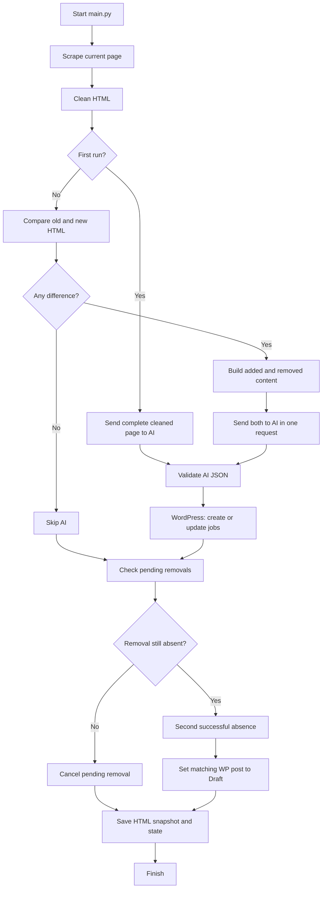

# Visual workflow – what happens during a run?

The terminal uses cyan section headings, green success messages, yellow pending-removal warnings and red errors.

## Flow

## What is sent to AI?

The AI request contains four main pieces of page information:

1. Added content – lines found in the new HTML only.
2. Removed content – lines found in the old HTML only.
3. Unified diff – both sides with nearby context.
4. Employer context – careers URL, employer name, default address and canton.

The AI does not receive a request only for additions or only for removals. Both directions are included together so it can see that one vacancy disappeared while another appeared.

## AI response

The AI must return:

| Field | Meaning |
|---|---|
| new_jobs | New vacancies found in added content |
| updated_jobs | Existing vacancies whose details changed |
| removed_jobs | Vacancies that may have disappeared |
| irrelevant_changes | Changes unrelated to vacancies |

Python validates the JSON and URLs before sending any job data to WordPress.

## WordPress decision table

| AI result | Python action |
|---|---|
| New job URL not in this employer's posts | Create |
| New job URL already exists | Update instead of duplicate |
| AI says updated and URL matches | Update |
| AI says updated, URL changed, one exact title match exists | Update that existing post |
| AI says removed | Queue for confirmation |
| URL is absent on a second successful scan | Set matching post to Draft |

Title matching is deliberately restricted to AI-classified updates and only used if exactly one existing post has that normalized title. A new job with the same title will not automatically overwrite another post.

## Removal protection

A newly detected removal starts at 1/2. The next successful scan checks the current page again:
- If the old job URL is back, cancel the removal.
- If it is still absent, set the matching published WordPress post to Draft.

A failed scrape or failed API operation does not save the new HTML snapshot. The next run can retry.

## Key concept

Python is responsible for downloading, comparing, validation, identity matching and API operations.

AI is responsible for understanding whether changed HTML describes a real job vacancy.

The HTML diff is generic. It does not depend on each website using a particular class name such as job-card or career-item.
